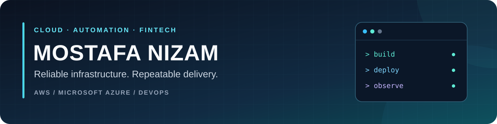

  

<h1 align="center">M O S T A F A &nbsp; N I Z A M</h1>
<h3 align="center">Head of IT &amp; FinTech Technology Leader | Cloud, DevSecOps &amp; Infrastructure</h3>

  <code>AWS</code> · <code>Microsoft Azure</code> · <code>CI/CD</code> · <code>Kubernetes</code> · <code>Infrastructure as Code</code> · <code>Observability</code>

  
  
  
  

<strong>Helping teams deploy with confidence and operate with clarity.</strong>

---

## 👋 About me

I help teams deploy applications, automate delivery, and manage infrastructure on **AWS and Microsoft Azure**. My IT career began in **2013**, with experience across FinTech and remittance systems. I combine hands-on engineering with leadership as **AGM and Head of IT**.

- **Cloud and automation:** application hosting, migrations, repeatable environments, and CI/CD pipelines.
- **Containers and operations:** Docker, Kubernetes, Linux and Windows servers, monitoring, and troubleshooting.
- **FinTech delivery:** API integrations, SQL Server, .NET/IIS and Java deployments, and backup and recovery planning.
- **Working approach:** clear communication, practical documentation, and maintainable handovers.

---

## 💼 Professional experience

As IT Manager, I led a **25-member IT team supporting 100+ users**. My responsibilities span infrastructure, ERP systems, application delivery and banking integrations.

| Role | Organization | Period |
| --- | --- | --- |
| **Assistant General Manager & Head of IT** | NEC Money Transfer Limited | Jan 2024 – Present |
| **IT Manager** | NEC Money Transfer Limited | Jan 2018 – Jan 2024 |

Earlier experience includes **IT Officer and Senior Officer IT** roles at **National Exchange Company**, covering networks, systems administration and remittance operations.

- **Technology leadership:** align IT strategy with business priorities, oversee architecture and ERP changes, and coordinate with management, banks and external partners.
- **Application delivery:** banking and partner API integrations, batch-file processing, .NET deployments on IIS, Java delivery pipelines, and infrastructure automation.
- **Infrastructure operations:** manage Windows and Linux environments, ERP platforms, load balancing and failover, and backup and recovery planning.
- **Delivery management:** requirements analysis, Agile/Scrum coordination, project status reporting, and communication with clients, vendors and technical teams.
- **Security and resilience:** endpoint security, log management, customer-data protection, backup and recovery planning, with experience addressing GDPR, FCA and SARB requirements in remittance operations.

---

## ⚡ Technology stack

### ☁️ Cloud platforms

  

**AWS · Microsoft Azure**

Additional cloud experience: **Google Cloud and DigitalOcean**.

Dedicated-server and data-center platforms: **OVH and Hetzner**.

### 🐳 Containers and infrastructure automation

  

**Docker · Kubernetes · Helm · Terraform · Ansible**

### 🔄 CI/CD and source control

  

**Jenkins · GitHub Actions · Azure DevOps · CircleCI · Git · Maven · Nexus**

### 📊 Monitoring and code quality

  

**Grafana · Prometheus · Zabbix · Loki · SonarQube · Trivy**

### 🛠️ Systems, scripting and applications

  

**Linux · Windows Server · Active Directory · Apache HTTP Server · Bash · PowerShell · Python · Go · .NET / IIS · Java deployments**

Virtualization: **Hyper-V · VMware Workstation · Vagrant**.

### 🔌 Integration and databases

**REST · SOAP · SQL Server · MySQL · Postman · SoapUI · JMeter**

### 🤝 Delivery and collaboration

**Agile / Scrum · Jira · ClickUp · Confluence · Stakeholder and vendor coordination**

---

## 📂 Featured projects

These public repositories document hands-on implementations and reference architectures.

### ☁️ AWS architecture and migration

| Project | What it covers |
| --- | --- |
| [AWS application rearchitecture](https://github.com/nizam754/Re-Architecting_Web_App_on_AWS_Cloud) | A multi-tier application using Elastic Beanstalk, RDS, ElastiCache, Amazon MQ, S3 and CloudFront. |
| [AWS lift-and-shift migration](https://github.com/nizam754/AWSCloudforWebAppSetup_LiftandShift) | Moving a multi-tier web application to AWS infrastructure. |

### 🚀 CI/CD and container delivery

| Project | What it covers |
| --- | --- |
| [Jenkins, Docker and Kubernetes](https://github.com/nizam754/cicd_Dock_Kube_Jen) | Container image builds, registry integration and Kubernetes deployment with Helm. |
| [Jenkins, Nexus and SonarQube](https://github.com/nizam754/CI_Using_Jenkins_Nexus_Sonarqube_Slack) | Builds, code analysis, artifact publishing and Slack notifications. |
| [Continuous integration on AWS](https://github.com/nizam754/CI_on_AWS_Cloud) | An AWS-based continuous integration workflow. |
| [Continuous delivery for Java](https://github.com/nizam754/Continuous_Delivery_of_Java_Web_Application) | A documented delivery workflow for a Java web application. |

### 🧩 Application environments

| Project | What it covers |
| --- | --- |
| [Automated multi-tier application setup](https://github.com/nizam754/Automated_Setup_of_Multi_Tier_App_Locally) | Automation for setting up a local multi-tier application environment. |
| [Multi-tier web application setup](https://github.com/nizam754/Multi_Tier_Web_Application_Setup_Locally) | A local application stack and its setup process. |

  <a href="https://github.com/nizam754/NizamDevOpsProjects"><strong>Explore the complete DevOps project collection →</strong></a>

---

## 🎯 Engineering focus

| Infrastructure | Delivery | Operations |
| --- | --- | --- |
| AWS and Azure environments | Repeatable CI/CD pipelines | Metrics, logs and dashboards |
| Terraform and Ansible | Docker and Kubernetes | Troubleshooting and runbooks |
| Cloud migration and architecture | Application and API integrations | Backup and recovery planning |

---

## 🏅 Certifications and training

| AWS Certified Solutions Architect – Associate | AWS Certified Cloud Practitioner | AWS Cloud Quest: Cloud Practitioner |
| :---: | :---: | :---: |
|  |  |  |
| **Certification** | **Certification** | **Training badge** |

Issued by **Amazon Web Services Training and Certification**. Select a badge to verify it on Credly.

### Google Cloud / Qwiklabs learning badges

<table>
  <tr>
    <td align="center" width="25%"> <strong>Cloud Engineering</strong></td>
    <td align="center" width="25%"> <strong>Windows on Google Cloud</strong></td>
    <td align="center" width="25%"> <strong>Cloud Development</strong></td>
    <td align="center" width="25%"> <strong>Data Engineering</strong></td>
  </tr>
  <tr>
    <td align="center" width="25%"> <strong>Google Cloud Essentials</strong></td>
    <td align="center" width="25%"> <strong>Exploring APIs</strong></td>
    <td align="center" width="25%"> <strong>Baseline: Data, ML, AI</strong></td>
    <td align="center" width="25%"><strong>Google Skills</strong> <a href="https://www.skills.google/public_profiles/631c5945-dce7-4006-bf5f-57cb957c605c">View all earned badges →</a></td>
  </tr>
</table>

Select a badge to view my earned credential on Google Skills.

### Microsoft Learn achievements

**72 module badges · 10 learning-path trophies**

#### Learning-path trophies

<table>
<tr>
<td align="center" width="20%"><a href="https://learn.microsoft.com/en-us/users/mostafanizam-8338/achievements/print/BGGLQEJD"> <b>GitHub fundamentals - Administration basics and product features.</b></a></td>
<td align="center" width="20%"><a href="https://learn.microsoft.com/en-us/users/mostafanizam-8338/achievements/print/FAW4QCJX"> <b>Implement Windows Server IaaS VM Identity</b></a></td>
<td align="center" width="20%"><a href="https://learn.microsoft.com/en-us/users/mostafanizam-8338/achievements/print/WXCQJWXN"> <b>AZ-400: Implement security and validate code bases for compliance</b></a></td>
<td align="center" width="20%"><a href="https://learn.microsoft.com/en-us/users/mostafanizam-8338/achievements/print/Q4ADHS2E"> <b>AZ-400: Design and implement a release strategy</b></a></td>
<td align="center" width="20%"><a href="https://learn.microsoft.com/en-us/users/mostafanizam-8338/achievements/print/8F6Z74GW"> <b>AZ-400: Implement CI with Azure Pipelines and GitHub Actions</b></a></td>
</tr>
<tr>
<td align="center" width="20%"><a href="https://learn.microsoft.com/en-us/users/mostafanizam-8338/achievements/print/EK7CMLQP"> <b>AZ-400: Development for enterprise DevOps</b></a></td>
<td align="center" width="20%"><a href="https://learn.microsoft.com/en-us/users/mostafanizam-8338/achievements/print/WXC7ULBN"> <b>AZ-400: Get started on a DevOps transformation journey</b></a></td>
<td align="center" width="20%"><a href="https://learn.microsoft.com/en-us/users/mostafanizam-8338/achievements/print/2BMP6SVS"> <b>Deploy applications with Azure DevOps</b></a></td>
<td align="center" width="20%"><a href="https://learn.microsoft.com/en-us/users/mostafanizam-8338/achievements/print/2KYNY7VS"> <b>Build applications with Azure DevOps</b></a></td>
<td align="center" width="20%"><a href="https://learn.microsoft.com/en-us/users/mostafanizam-8338/achievements/print/UY8V6C3J"> <b>Get started with Azure DevOps</b></a></td>
</tr>
</table>

<strong>View all 72 Microsoft Learn module badges</strong>

<table>
<tr>
<td align="center" width="25%"><a href="https://learn.microsoft.com/en-us/users/mostafanizam-8338/achievements/print/UXXYBH73"> <b>Introduction to prompt engineering with GitHub Copilot</b></a></td>
<td align="center" width="25%"><a href="https://learn.microsoft.com/en-us/users/mostafanizam-8338/achievements/print/CNNFECU9"> <b>Using GitHub Copilot with Python</b></a></td>
<td align="center" width="25%"><a href="https://learn.microsoft.com/en-us/users/mostafanizam-8338/achievements/print/455LC59K"> <b>Search and organize repository history by using GitHub</b></a></td>
<td align="center" width="25%"><a href="https://learn.microsoft.com/en-us/users/mostafanizam-8338/achievements/print/PSSSXT64"> <b>Manage repository changes by using pull requests on GitHub</b></a></td>
</tr>
<tr>
<td align="center" width="25%"><a href="https://learn.microsoft.com/en-us/users/mostafanizam-8338/achievements/print/NZZZ2C6F"> <b>Authenticate and authorize user identities on GitHub</b></a></td>
<td align="center" width="25%"><a href="https://learn.microsoft.com/en-us/users/mostafanizam-8338/achievements/print/9FFN559U"> <b>Introduction to GitHub administration</b></a></td>
<td align="center" width="25%"><a href="https://learn.microsoft.com/en-us/users/mostafanizam-8338/achievements/print/NZZAKSXF"> <b>Maintain a secure repository by using GitHub best practices</b></a></td>
<td align="center" width="25%"><a href="https://learn.microsoft.com/en-us/users/mostafanizam-8338/achievements/print/D66TWMXJ"> <b>Manage an InnerSource program by using GitHub</b></a></td>
</tr>
<tr>
<td align="center" width="25%"><a href="https://learn.microsoft.com/en-us/users/mostafanizam-8338/achievements/print/8AR8HEPW"> <b>Contribute to an open-source project on GitHub</b></a></td>
<td align="center" width="25%"><a href="https://learn.microsoft.com/en-us/users/mostafanizam-8338/achievements/print/VBKVR4LM"> <b>Communicate effectively on GitHub using Markdown</b></a></td>
<td align="center" width="25%"><a href="https://learn.microsoft.com/en-us/users/mostafanizam-8338/achievements/print/JC6JVJQT"> <b>Manage your work with GitHub Projects</b></a></td>
<td align="center" width="25%"><a href="https://learn.microsoft.com/en-us/users/mostafanizam-8338/achievements/print/NZ73NYNF"> <b>Code with GitHub Codespaces</b></a></td>
</tr>
<tr>
<td align="center" width="25%"><a href="https://learn.microsoft.com/en-us/users/mostafanizam-8338/achievements/print/45SM23ZK"> <b>Introduction to GitHub Copilot</b></a></td>
<td align="center" width="25%"><a href="https://learn.microsoft.com/en-us/users/mostafanizam-8338/achievements/print/9FNSGZWU"> <b>Introduction to GitHub's products</b></a></td>
<td align="center" width="25%"><a href="https://learn.microsoft.com/en-us/users/mostafanizam-8338/achievements/print/QJDAY7NE"> <b>Introduction to GitHub</b></a></td>
<td align="center" width="25%"><a href="https://learn.microsoft.com/en-us/users/mostafanizam-8338/achievements/print/9FNT9RKU"> <b>Introduction to Git</b></a></td>
</tr>
<tr>
<td align="center" width="25%"><a href="https://learn.microsoft.com/en-us/users/mostafanizam-8338/achievements/print/8XTR362W"> <b>Introduction to Azure OpenAI Service</b></a></td>
<td align="center" width="25%"><a href="https://learn.microsoft.com/en-us/users/mostafanizam-8338/achievements/print/98NA9DQU"> <b>Deploy and manage Azure IaaS Active Directory domain controllers in Azure</b></a></td>
<td align="center" width="25%"><a href="https://learn.microsoft.com/en-us/users/mostafanizam-8338/achievements/print/NRHQPTBF"> <b>Implement hybrid identity with Windows Server</b></a></td>
<td align="center" width="25%"><a href="https://learn.microsoft.com/en-us/users/mostafanizam-8338/achievements/print/C8FPA4N9"> <b>Security Monitoring and Governance</b></a></td>
</tr>
<tr>
<td align="center" width="25%"><a href="https://learn.microsoft.com/en-us/users/mostafanizam-8338/achievements/print/JGG5KC4T"> <b>OWASP and Dynamic Analyzers</b></a></td>
<td align="center" width="25%"><a href="https://learn.microsoft.com/en-us/users/mostafanizam-8338/achievements/print/WRZUEHMN"> <b>Static analyzers</b></a></td>
<td align="center" width="25%"><a href="https://learn.microsoft.com/en-us/users/mostafanizam-8338/achievements/print/2PBN56AV"> <b>Software Composition Analysis</b></a></td>
<td align="center" width="25%"><a href="https://learn.microsoft.com/en-us/users/mostafanizam-8338/achievements/print/KTEVM8ZB"> <b>Implement open-source software</b></a></td>
</tr>
<tr>
<td align="center" width="25%"><a href="https://learn.microsoft.com/en-us/users/mostafanizam-8338/achievements/print/ZQ7RD642"> <b>Introduction to Secure DevOps</b></a></td>
<td align="center" width="25%"><a href="https://learn.microsoft.com/en-us/users/mostafanizam-8338/achievements/print/3W5QV2VH"> <b>Automate inspection of health</b></a></td>
<td align="center" width="25%"><a href="https://learn.microsoft.com/en-us/users/mostafanizam-8338/achievements/print/7Q23JTMZ"> <b>Manage and modularize tasks and templates</b></a></td>
<td align="center" width="25%"><a href="https://learn.microsoft.com/en-us/users/mostafanizam-8338/achievements/print/KJKTNF9B"> <b>Provision and test environments</b></a></td>
</tr>
<tr>
<td align="center" width="25%"><a href="https://learn.microsoft.com/en-us/users/mostafanizam-8338/achievements/print/X7UA3RFY"> <b>Explore release recommendations</b></a></td>
<td align="center" width="25%"><a href="https://learn.microsoft.com/en-us/users/mostafanizam-8338/achievements/print/3NF6CEWH"> <b>Create a release pipeline</b></a></td>
<td align="center" width="25%"><a href="https://learn.microsoft.com/en-us/users/mostafanizam-8338/achievements/print/HF3APY38"> <b>Introduction to continuous delivery</b></a></td>
<td align="center" width="25%"><a href="https://learn.microsoft.com/en-us/users/mostafanizam-8338/achievements/print/ZQGCRYM2"> <b>Design a container build strategy</b></a></td>
</tr>
<tr>
<td align="center" width="25%"><a href="https://learn.microsoft.com/en-us/users/mostafanizam-8338/achievements/print/FAFAFJ7X"> <b>Learn continuous integration with GitHub Actions</b></a></td>
<td align="center" width="25%"><a href="https://learn.microsoft.com/en-us/users/mostafanizam-8338/achievements/print/WY8PBP5N"> <b>Introduction to GitHub Actions</b></a></td>
<td align="center" width="25%"><a href="https://learn.microsoft.com/en-us/users/mostafanizam-8338/achievements/print/WYHJM9VN"> <b>Integrate with Azure Pipelines</b></a></td>
<td align="center" width="25%"><a href="https://learn.microsoft.com/en-us/users/mostafanizam-8338/achievements/print/UW66EB53"> <b>Implement a pipeline strategy</b></a></td>
</tr>
<tr>
<td align="center" width="25%"><a href="https://learn.microsoft.com/en-us/users/mostafanizam-8338/achievements/print/BS7JSPSD"> <b>Explore continuous integration</b></a></td>
<td align="center" width="25%"><a href="https://learn.microsoft.com/en-us/users/mostafanizam-8338/achievements/print/7MSA4Y9Z"> <b>Describe pipelines and concurrency</b></a></td>
<td align="center" width="25%"><a href="https://learn.microsoft.com/en-us/users/mostafanizam-8338/achievements/print/8YNXU7VW"> <b>Manage Azure Pipeline agents and pools</b></a></td>
<td align="center" width="25%"><a href="https://learn.microsoft.com/en-us/users/mostafanizam-8338/achievements/print/3NDZBSKH"> <b>Explore Azure Pipelines</b></a></td>
</tr>
<tr>
<td align="center" width="25%"><a href="https://learn.microsoft.com/en-us/users/mostafanizam-8338/achievements/print/QBPC5WHE"> <b>Manage Git repositories</b></a></td>
<td align="center" width="25%"><a href="https://learn.microsoft.com/en-us/users/mostafanizam-8338/achievements/print/WRR5LT6N"> <b>Plan foster inner source</b></a></td>
<td align="center" width="25%"><a href="https://learn.microsoft.com/en-us/users/mostafanizam-8338/achievements/print/D52HVZEJ"> <b>Explore Git hooks</b></a></td>
<td align="center" width="25%"><a href="https://learn.microsoft.com/en-us/users/mostafanizam-8338/achievements/print/2ER5C58V"> <b>Identify technical debt</b></a></td>
</tr>
<tr>
<td align="center" width="25%"><a href="https://learn.microsoft.com/en-us/users/mostafanizam-8338/achievements/print/WX3A79AN"> <b>Collaborate with pull requests in Azure Repos</b></a></td>
<td align="center" width="25%"><a href="https://learn.microsoft.com/en-us/users/mostafanizam-8338/achievements/print/WRFET69N"> <b>Manage Git branches and workflows</b></a></td>
<td align="center" width="25%"><a href="https://learn.microsoft.com/en-us/users/mostafanizam-8338/achievements/print/HXAUQAH8"> <b>Structure your Git Repo</b></a></td>
<td align="center" width="25%"><a href="https://learn.microsoft.com/en-us/users/mostafanizam-8338/achievements/print/PJ6ZAK84"> <b>Work with Azure Repos and GitHub</b></a></td>
</tr>
<tr>
<td align="center" width="25%"><a href="https://learn.microsoft.com/en-us/users/mostafanizam-8338/achievements/print/KTW5VMPB"> <b>Describe types of source control systems</b></a></td>
<td align="center" width="25%"><a href="https://learn.microsoft.com/en-us/users/mostafanizam-8338/achievements/print/3NU9B63H"> <b>Introduction to source control</b></a></td>
<td align="center" width="25%"><a href="https://learn.microsoft.com/en-us/users/mostafanizam-8338/achievements/print/JGGFDV2T"> <b>Plan Agile with GitHub Projects and Azure Boards</b></a></td>
<td align="center" width="25%"><a href="https://learn.microsoft.com/en-us/users/mostafanizam-8338/achievements/print/HXFZW4T8"> <b>Choose the DevOps tools</b></a></td>
</tr>
<tr>
<td align="center" width="25%"><a href="https://learn.microsoft.com/en-us/users/mostafanizam-8338/achievements/print/3NQCSL8H"> <b>Describe team structures</b></a></td>
<td align="center" width="25%"><a href="https://learn.microsoft.com/en-us/users/mostafanizam-8338/achievements/print/NY3UC8WF"> <b>Choose the right project</b></a></td>
<td align="center" width="25%"><a href="https://learn.microsoft.com/en-us/users/mostafanizam-8338/achievements/print/NRWQACRF"> <b>Introduction to DevOps</b></a></td>
<td align="center" width="25%"><a href="https://learn.microsoft.com/en-us/users/mostafanizam-8338/achievements/print/FVYU43XN"> <b>Automate multi-container Kubernetes deployments with Azure Pipelines</b></a></td>
</tr>
<tr>
<td align="center" width="25%"><a href="https://learn.microsoft.com/en-us/users/mostafanizam-8338/achievements/print/CFUT7598"> <b>Automate Docker container deployments with Azure Pipelines</b></a></td>
<td align="center" width="25%"><a href="https://learn.microsoft.com/en-us/users/mostafanizam-8338/achievements/print/WZFRKENA"> <b>Automate Azure Functions deployments with Azure Pipelines</b></a></td>
<td align="center" width="25%"><a href="https://learn.microsoft.com/en-us/users/mostafanizam-8338/achievements/print/N2VDS8FL"> <b>Manage release cadence in Azure Pipelines by using deployment patterns</b></a></td>
<td align="center" width="25%"><a href="https://learn.microsoft.com/en-us/users/mostafanizam-8338/achievements/print/FVEJNNXN"> <b>Run nonfunctional tests in Azure Pipelines</b></a></td>
</tr>
<tr>
<td align="center" width="25%"><a href="https://learn.microsoft.com/en-us/users/mostafanizam-8338/achievements/print/P5G2VA4J"> <b>Run functional tests in Azure Pipelines</b></a></td>
<td align="center" width="25%"><a href="https://learn.microsoft.com/en-us/users/mostafanizam-8338/achievements/print/PSE7794J"> <b>Create a multistage pipeline by using Azure Pipelines</b></a></td>
<td align="center" width="25%"><a href="https://learn.microsoft.com/en-us/users/mostafanizam-8338/achievements/print/D6DN26JN"> <b>Create a release pipeline in Azure Pipelines</b></a></td>
<td align="center" width="25%"><a href="https://learn.microsoft.com/en-us/users/mostafanizam-8338/achievements/print/ZKEGBH2S"> <b>Host your own build agent in Azure Pipelines</b></a></td>
</tr>
<tr>
<td align="center" width="25%"><a href="https://learn.microsoft.com/en-us/users/mostafanizam-8338/achievements/print/2BK6FGVS"> <b>Manage build dependencies with Azure Artifacts</b></a></td>
<td align="center" width="25%"><a href="https://learn.microsoft.com/en-us/users/mostafanizam-8338/achievements/print/B63G6JDG"> <b>Run quality tests in your build pipeline by using Azure Pipelines</b></a></td>
<td align="center" width="25%"><a href="https://learn.microsoft.com/en-us/users/mostafanizam-8338/achievements/print/87RYBRWF"> <b>Implement a code workflow in your build pipeline by using Git and GitHub</b></a></td>
<td align="center" width="25%"><a href="https://learn.microsoft.com/en-us/users/mostafanizam-8338/achievements/print/8A3E2EWF"> <b>Create a build pipeline with Azure Pipelines</b></a></td>
</tr>
<tr>
<td align="center" width="25%"><a href="https://learn.microsoft.com/en-us/users/mostafanizam-8338/achievements/print/DCCG99JN"> <b>Manage Agile software delivery plans across teams</b></a></td>
<td align="center" width="25%"><a href="https://learn.microsoft.com/en-us/users/mostafanizam-8338/achievements/print/3Y6VQYH9"> <b>Choose an Agile approach to software development</b></a></td>
<td align="center" width="25%"><a href="https://learn.microsoft.com/en-us/users/mostafanizam-8338/achievements/print/HNWTNDF8"> <b>Introduction to Azure DevOps</b></a></td>
<td align="center" width="25%"><a href="https://learn.microsoft.com/en-us/users/mostafanizam-8338/achievements/print/QJRPVJE5"> <b>Assess your existing software development process</b></a></td>
</tr>
</table>

Select any badge or trophy to view my Microsoft Learn achievement.

<strong>Additional professional training</strong>

- **Cloud and DevOps:** Microsoft Azure, Linux security, GitHub Actions and Python for DevOps; *DevOps Beginners to Advanced — Decoding DevOps with Projects* (Udemy); DevOps and Go coding boot camps (Master Academy).
- **Windows Server and security:** *Windows Server 2019 Essential Training* and *Securing Windows Server 2019* (LinkedIn Learning / Lynda).
- **Architecture and databases:** *Software Architecture: Domain-Driven Design* and *Querying Microsoft SQL Server 2019* (LinkedIn Learning / Lynda).
- **Networking:** CCNA coursework at American International University-Bangladesh.
- **FinTech compliance:** *Anti-Money Laundering & Terrorist Financing Approaches* (ABM Global Compliance UK Limited) and *Anti-Money Laundering Concepts: AML, KYC and Compliance* (Udemy).

[View badges on Credly →](https://www.credly.com/users/mostafa-nizam) · [View additional training on LinkedIn →](https://www.linkedin.com/in/mn754/details/certifications/)

---

## 📊 GitHub activity

### Repository statistics

  
  

---

## 🤝 Let's work together

Need help with **AWS or Azure infrastructure, CI/CD automation, container deployments, monitoring, or FinTech integrations**?

Share your current stack, the problem you want to solve, and your target timeline. I can help define a focused implementation and handover.

  <a href="https://www.upwork.com/freelancers/~010cee382438196f3c"><strong>Discuss a project on Upwork</strong></a>
  &nbsp; · &nbsp;
  <a href="https://www.fiverr.com/m_nizam"><strong>Message me on Fiverr</strong></a>
  &nbsp; · &nbsp;
  <a href="https://www.linkedin.com/in/mn754/"><strong>Connect on LinkedIn</strong></a>

